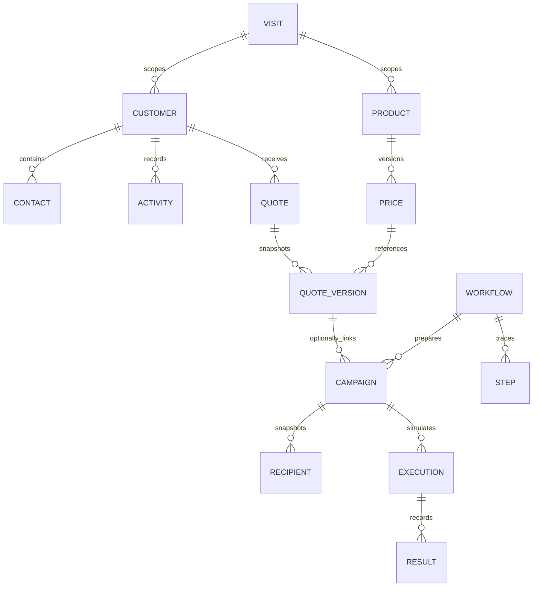

# Architecture

## Components
- web/: original HTML, responsive CSS and vanilla JavaScript. Screens are populated by REST APIs.
- server.py: same-origin JSON boundary, visitor sessions, CSRF, simulated roles, request limits, static allowlist.
- operations/storage.py: SQLite, foreign keys, WAL and checksummed transactional migrations.
- operations/domain.py: CRM, imports, snapshots, campaigns, approvals, simulations and traces.
- operations/rules.py: explicit local segmentation/templates, Decimal arithmetic, deterministic outcomes.
- operations/seed.py: independent fictional records generated for each visitor.
- migrations/, tests/, tools/: schema, regression and release verification.

No external application connector, model request, mail transport or tracking service is implemented.

## Relationships

All business tables carry a visitor key. Composite foreign keys prevent cross-workspace business references. Each API object lookup includes the current visitor key; an integer ID alone grants no access.

Prices are separate append-only records. Quotations store immutable descriptions and Decimal-text monetary values, keeping history stable after a price update. SQLite triggers prevent snapshot or approval updates. USD totals use half-up cent rounding and an explicit fictional 8% tax.

## State and idempotency
- CSV SHA-256 is unique per visitor. Duplicate imports reuse their batch and workflow.
- Validation is all-or-nothing for products; a rejected import persists an error trace.
- Master-data conflicts do not overwrite confirmed names or categories.
- Quotations create successive snapshots, with expected_version checks and separate approval.
- Campaign DRAFT -> APPROVED -> SIMULATED. Content changes increment revision and invalidate approval.
- A canonical hash binds subject, body, audience decisions and linked quotation version.
- Execution rechecks preferences and current approval. Unique execution keys make retries safe.
- Workflow steps retain DONE, WAITING and ERROR states; runs expose FAILED, BLOCKED and COMPLETED.
- Reset cascades only the current visitor's records and rotates the cookie and CSRF token.

The role selector intentionally lets any visitor explore both demo personas. It is not verification of two independent real identities.

## Lifecycle
GET /api/session seeds a random workspace. An HttpOnly SameSite=Strict cookie holds a bearer token; only its hash is stored. HTTPS adds Secure. POST checks Host, Origin, fetch-site metadata, CSRF, expiry and bounds inside a transaction. Sessions expire after four hours; physical cleanup occurs on new workspace creation.

A retained SQLite file survives process restart and browser reload. An ephemeral file lost on hosting restart causes a fresh seeded workspace after reload. One instance is intentional; horizontal scaling and durable user accounts require another storage/authentication design.

## REST API
| Route | Purpose |
| --- | --- |
| GET /health | No-data service health |
| GET /api/session | Start/resume visitor |
| GET /api/state | Only current visitor data |
| POST /api/persona | Simulated role switch |
| POST /api/reset | Reset own visitor |
| POST /api/customers | Fictional lead/contact |
| POST /api/customers/:id/stage | Lead transition |
| POST /api/contacts/:id/preference | Suppression preference |
| POST /api/imports | CSV validation and workflow |
| POST /api/quotes | Quotation snapshot |
| POST /api/quotes/:id/versions | New snapshot |
| POST /api/quotes/:id/approve | Reviewer-only approval |
| GET /api/quotes/:id/compare?a=1&b=2 | Version differences |
| POST /api/campaigns | From approved quote |
| POST /api/campaigns/:id/revise | Revision / approval reset |
| POST /api/campaigns/:id/approve | Current revision approval |
| POST /api/campaigns/:id/execute | Local simulation only |

## Runtime boundary
Single bounded standard-library HTTP service behind a hosting TLS proxy, SQLite on local storage, no worker infrastructure. Thread/body/record/write/workspace limits protect a small portfolio demo. This is not a hardened production business system.
