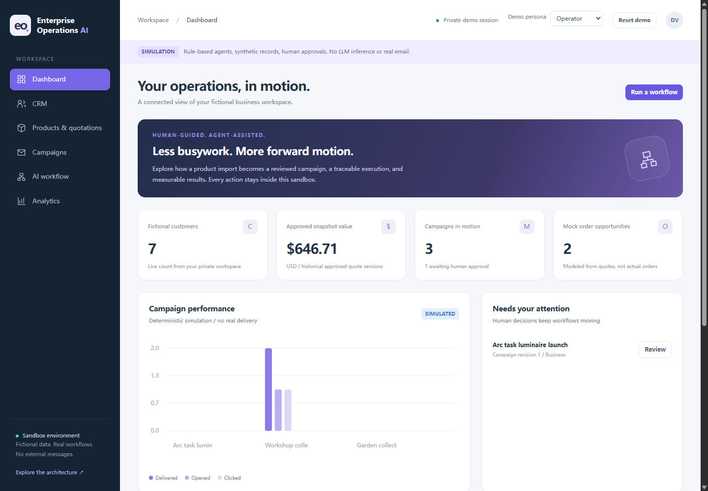
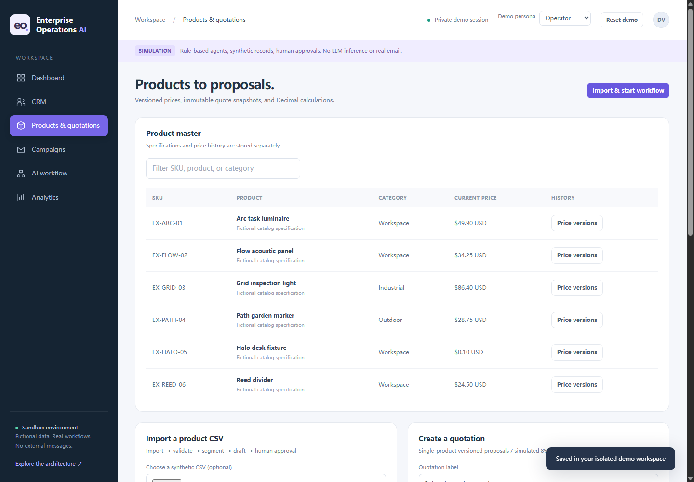
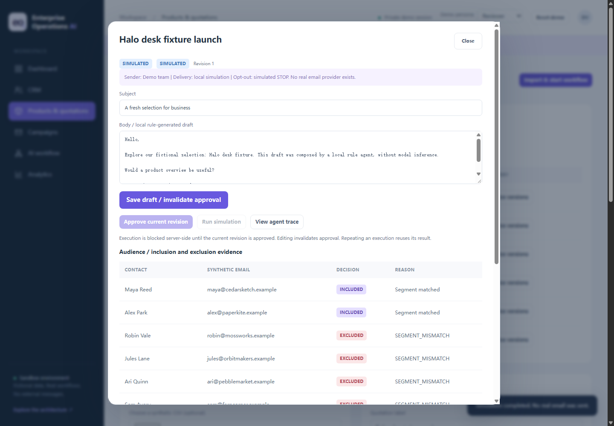
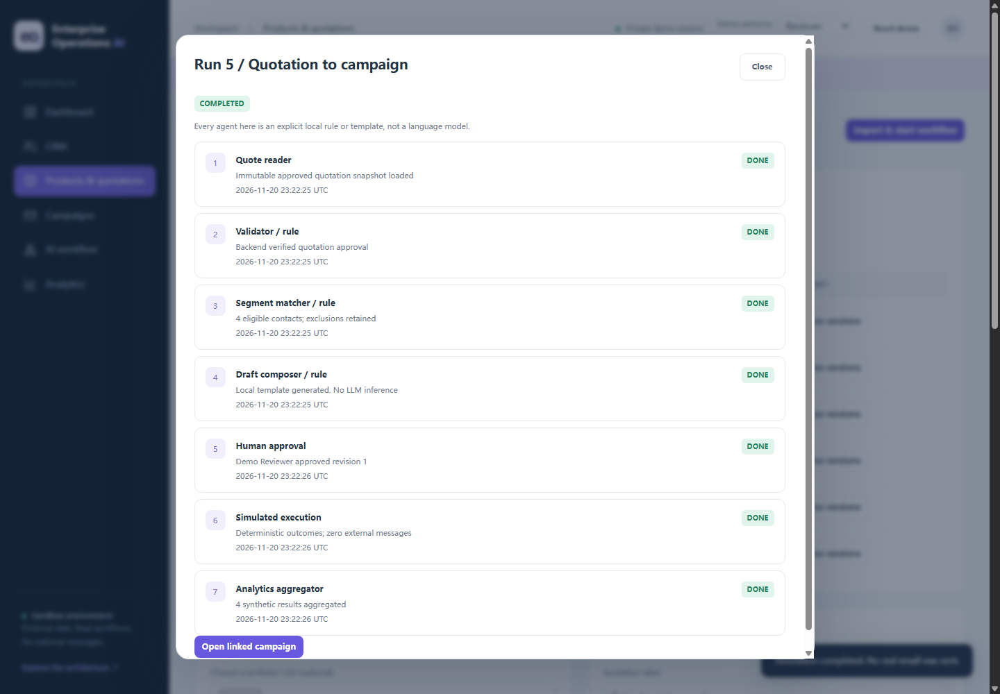
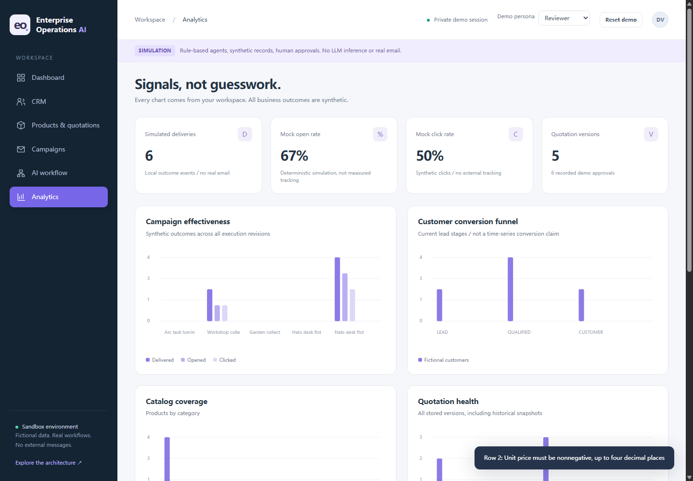
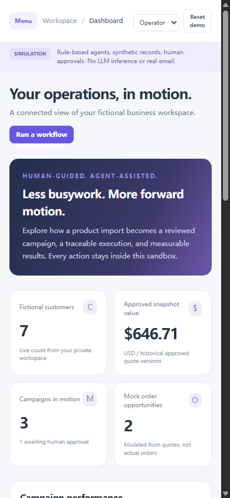
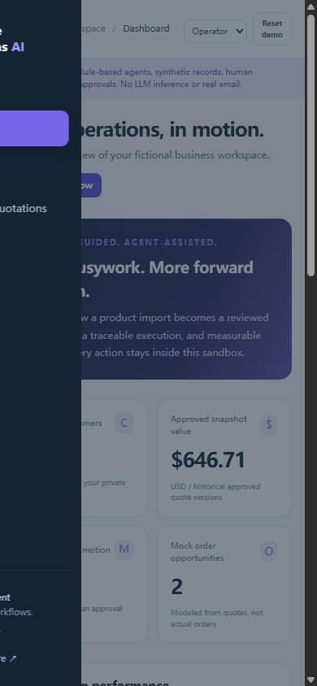
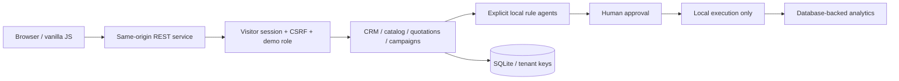
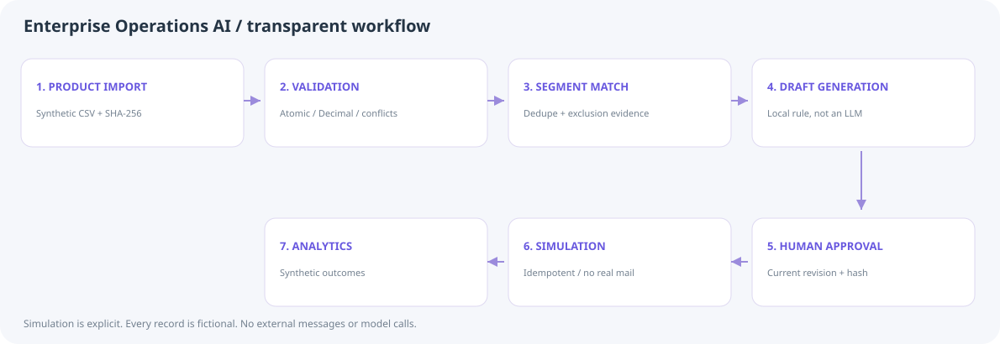

# Enterprise Operations AI
### Agentic Workflow Automation Platform

**[Live Demo](https://enterprise-operations-ai.onrender.com) | [GitHub](https://github.com/hwen020/enterprise-operations-ai)**

A working full-stack portfolio sandbox that connects fictional CRM records, versioned quotations, approval-gated campaigns, transparent rule agents, and synthetic analytics.

**Simulation is explicit.** Persistence, REST APIs, validation, visitor isolation, versioning, and approval gates are implemented. Agent composition uses local rules and templates, not an LLM. Execution creates deterministic local results, never real messages.



## Explore the six modules

| Module | Implemented |
| --- | --- |
| Dashboard | Database-backed KPIs, simulated campaign chart, approval queue, activity timeline |
| CRM | Fictional companies and contacts, search, lead-stage filters, preferences, activity history |
| Product & quotation | Atomic CSV validation, source batches, versioned prices, Decimal totals, immutable snapshots, version comparison and approval |
| Campaign | Segment matching, deduplication, suppression reasons, editable drafts, revision-bound approval, idempotent simulated execution |
| AI workflow | Inspectable seven-step runs with agent labels, timestamps, waiting states, approvals, and persisted validation errors |
| Analytics | Simulated results, current-stage customer funnel, catalog coverage, quotation health, approval audit |

Mock order opportunities are derived from approved quotations and labeled as modeled opportunities, not a real order-management system. Open/click outcomes are synthetic, not measured email events. The UI lets each visitor switch between **demo Operator** and **demo Reviewer**; this illustrates backend approval constraints, not production identity verification.

## Run locally

Python 3.8+ is supported by the local acceptance run. Use a currently supported, patched Python runtime for internet hosting. No packages, keys, Node build, or model account are required.

```sh
python -m venv .venv
# Linux/macOS: source .venv/bin/activate
# Windows: .venv\Scripts\activate
python -m pip install --no-index -r requirements.txt
python -B server.py
```

Open **http://127.0.0.1:8790**. The first visit automatically receives a complete fictional workspace. No login or password is necessary.

## Eight-step demo

1. Inspect Dashboard and its simulation labels.
2. Open CRM, search a company, and change a lead stage.
3. In Products & quotations, load the sample CSV and select **Validate & run agents**.
4. Create a quotation, open its versions, create a revision, and compare snapshots.
5. Switch to the demo Reviewer in the detail panel; approve a quotation version.
6. Create its campaign; review the full recipient list and exclusion reasons.
7. Approve the current campaign revision, then select **Run simulation**.
8. Inspect its workflow trace and Analytics. Reset affects only your visitor workspace.

CSV categories are Workspace, Industrial, or Outdoor; currency is USD. The 8% tax is an explicit fictional rule. Invalid rows reject the entire import and leave a failed workflow trace. Duplicate CSV content reuses its batch; repeat executions reuse their results. Product conflicts never overwrite confirmed names or categories.

## Screenshots

| Product and quote versions | Campaign review |
| --- | --- |
|  |  |

| Workflow trace | Analytics |
| --- | --- |
|  |  |

<details><summary>390px mobile experience</summary>




</details>

All marks, diagrams, fixtures, example PDF, and browser screenshots originate in this repository. There are no stock photos, external fonts, UI kits, or vendored application sources. The example [fictional quotation PDF](assets/example-quotation.pdf) is generated by `tools/generate_assets.py`; PDF parsing is not an implemented feature.

## Architecture





The backend uses Python's standard library and SQLite with checked migrations, transactions, composite tenant foreign keys, immutable financial snapshots, expiring HttpOnly sessions, input limits, CSRF/origin checks, and bounded request concurrency. See [ARCHITECTURE](ARCHITECTURE.md) and [SECURITY](SECURITY.md).

## Verify

```sh
python -B -m unittest discover -s tests -v
python -B tools/verify.py
# Optional: installed Chrome/Chromium; BROWSER_BIN overrides discovery
python -B tools/browser_check.py
python -B tools/public_scan.py
python -B tools/clean_check.py
```

Evidence is recorded in [VALIDATION](docs/VALIDATION.md), [automated results](docs/test-validation.json), and [browser results](docs/browser-validation.json). Browser checks run against fresh isolated databases and generated demo accounts; they do not contact a business API.

## Live Demo and deployment

**Live Demo: [Open the live sandbox](https://enterprise-operations-ai.onrender.com)**

Public acceptance passed: 30 desktop checks, 32 mobile checks at 390px, 33 HTTPS API checks, zero browser runtime/HTTP 5xx errors, and an actual Free-service restart/reseed check. See [public validation evidence](docs/live-validation.json).

[render.yaml](render.yaml) describes the deployed single Free native Python service. [SETUP](SETUP.md) explains environment variables, health checks and optional Docker use. [RELEASE](RELEASE.md) documents the published repository and deployment checks. Subsequent changes should repeat the publication review.

Render free services lose local SQLite files on restarts, redeploys, or spin-down. This project deliberately treats that storage as disposable: a returning cookie receives a newly seeded workspace after data loss. While the process/filesystem remains available, data survives refreshes and server restarts that retain the file. Visitors cannot read or reset another workspace. Do not use this deployment for real records or durable business storage. See [Render's free-service documentation](https://render.com/docs/free).

## Scope and next steps

Implemented: six connected modules, local rules, durable SQLite records on a retained filesystem, snapshots and approval constraints, per-visitor isolation, reset, tests, and responsive UI.

Not implemented: actual model inference, real email, external CRM/carrier connectors, real orders, billing, organization accounts, production SSO/RBAC, distributed jobs. Future work may include proper authenticated teams, a durable hosted database, and approved external adapters. They are not prerequisites for exploring this sandbox.

Newly authored project code and assets are licensed under [MIT](LICENSE), with copyright attributed to hwen020. Runtime/tool licenses and provenance are documented in [THIRD_PARTY_NOTICES](THIRD_PARTY_NOTICES.md). This is an AI-assisted implementation with executable tests and explicit capability limits.
